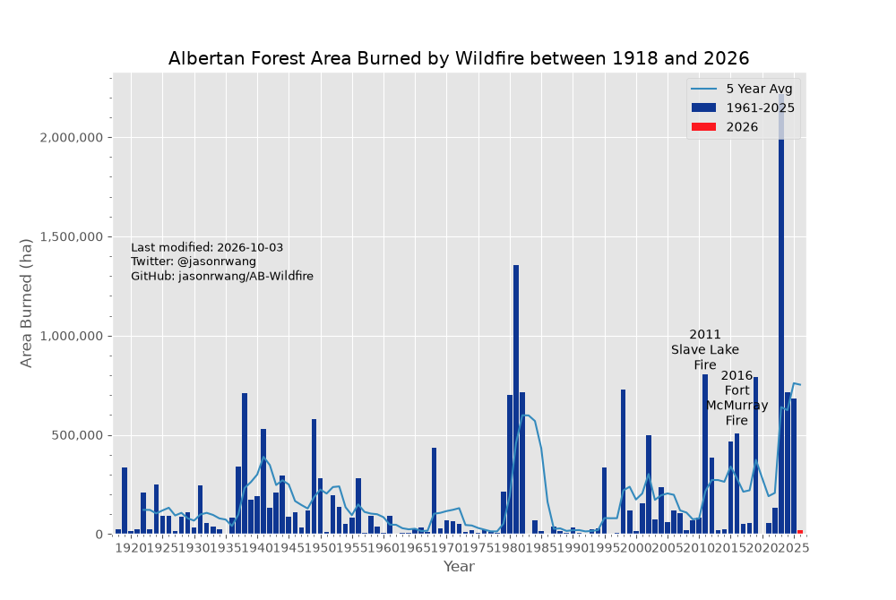
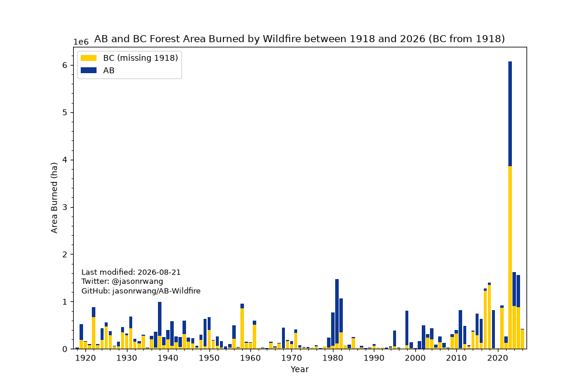
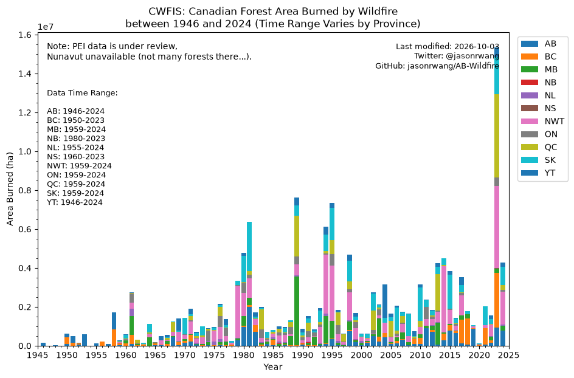

# Alberta and British Columbia Wildfire Area Statistics Compilation

A quick peek into Alberta and British Columbia's wildfire histories (I started with just Alberta).

**Interactive dashboard, updated daily: https://jasonrwang.github.io/AB-Wildfire/**

Or take a look at this analysis yourself:
[](https://mybinder.org/v2/gh/jasonrwang/AB-Wildfire/main?urlpath=lab)

Last modified: 2026-10-03 (or the latest date shown on my GitHub repo)

## Preamble

Wildfire season has hit Alberta once again, and my friends and family back home are posting feverously on social media about the orange haze that has hit Alberta. Of course, there's similarly bickering about how much of this is 'normal'. We know that wildfires are intensified by the climate emergency, but there are undoubtedly many more causes.

The purpose of this little notebook is just to answer a question that's been on my mind: _how does this wildfire season actually compare to previous years?_ Surprisingly, this wasn't very easy to find online, so I decided to do some work myself.

Of course this analysis is limited by the quality of data available. I've done my best to double check and, where I could, validate these numbers by cross-referencing them across multiple government-published data sources.

Lastly, I want to thank all the brave lookout staff, firefighters, civil servants, and countless more people on the frontlines fighting the fires. It's a dangerous and incredibly tiring job to deal with such crises. Similarly, my heart goes out to all those displaced by the fires.

_2019-06-01: [Simon Bridge](https://twitter.com/srjbridge) pointed out to me that I missed a dataset from the Canadian Wildfire Info System Datamart, which I had been looking at, actually has data for all provinces from 1950 to 2016. It's listed under 'National Fire Database fire point data' at the [CWFIS site](http://cwfis.cfs.nrcan.gc.ca/datamart). Thanks Simon._





_2026: Plots are now interactive! See `Visualizations.ipynb`, built with [Altair](https://altair-viz.github.io/), for a zoomable/filterable version of the main charts above._

_2026-08-10: AB and BC data now extend through the current fire season, live, sourced directly from [Alberta's Open Government wildfire data](https://open.alberta.ca/opendata/wildfire-data) + its [year-to-date feed](https://www.alberta.ca/wildfire-maps-and-data) and the [BC Wildfire Service's historical](https://catalogue.data.gov.bc.ca/dataset/bc-wildfire-fire-perimeters-historical) + [current fire perimeters](https://catalogue.data.gov.bc.ca/dataset/bc-wildfire-fire-perimeters-current), instead of the old one-off live scrapers, which had stopped working as both source pages went offline. `CA-Wildfire.ipynb` (Canada-wide by province) now also pulls current years from NRCan's live [National Fire Database](https://cwfis.cfs.nrcan.gc.ca/datamart) feed, on top of the original 2018 snapshot — note this only tracks fires ≥ 200 ha, and, being a live feed, its most recent complete year may lag AB/BC's own official data by a year._

_2026-10-03: The interactive charts are now published as a [dashboard on GitHub Pages](https://jasonrwang.github.io/AB-Wildfire/), rebuilt every day from the live feeds above._

## Data

The compiled data is available as CSV:

- **Latest (updated daily):** download links under each chart on the [dashboard](https://jasonrwang.github.io/AB-Wildfire/).
- **In this repo:** [`data/ABWildfires.csv`](data/ABWildfires.csv) (individual Alberta fires: `Year`, `Area` in hectares), [`data/BCWildfires.csv`](data/BCWildfires.csv) (BC yearly totals), [`data/CAWildfires.csv`](data/CAWildfires.csv) (yearly area and area normalized by land area, by province). These are refreshed by a monthly snapshot commit, so the git history doubles as a dated record of the data.

## Setup

This project uses [`uv`](https://docs.astral.sh/uv/) to manage its Python environment and dependencies.

```bash
uv sync
uv run jupyter lab
```

`uv sync` installs the pinned dependencies (pandas, altair, matplotlib, requests, jupyter) into a local `.venv`, and `uv run jupyter lab` launches JupyterLab so you can open and run the notebooks below.

To build the dashboard locally (after running the AB, BC, and CA notebooks to refresh `data/`):

```bash
uv run python -m dashboard.build
```

This writes `_site/index.html`. The chart definitions live in `dashboard/charts.py` and are shared with `Visualizations.ipynb`.

### To Do:

- Look at other factors for fires, like aridity and duration of actual fire season

#### A guide to my logic:

I wrote these files in the following order; it might make sense to read them that way too.

1. AB-Wildfire
2. BC-Wildfire
3. Summary Stats
4. CA-Wildfire
5. Visualizations _(interactive dashboard of the main charts above)_

### For more reading:

#### Explained

- [Carman, Tara (2017, July 29). Area of B.C. burned by wildfires at a 56-year high. CBC News.](https://www.cbc.ca/news/canada/british-columbia/area-of-b-c-burned-by-wildfires-at-a-56-year-high-1.4226227)
- Tara Carman's [GitHub Repo](https://github.com/taracarman/BC_Wildfires/blob/master/BC%20Wildfires.ipynb) for the above story; this project also partly inspired by Tara's work!
- [Nadkarni, Kabir (2018, September 01). Opinion: UCP's climate denial unacceptable in face of worsening wildfire trends. The Gateway.](https://www.thegatewayonline.ca/2018/09/ucp-climate-denial-unacceptable-wildfire-trends/)
- [McGillivray, Glenn (2019, May 29). Opinion: Climate change is a big factor in Alberta’s wildfires – but not in the way you might think. The Globe and Mail.](https://www.theglobeandmail.com/opinion/article-climate-change-is-a-big-factor-in-albertas-wildfires-but-not-in-the/)
- [Pierre-Louis, Kendra & Popovich, Nadja (2018, November 27). Climate Change Is Fueling Wildfires Nationwide, New Report Warns. The New York Times.](https://www.nytimes.com/interactive/2018/11/27/climate/wildfire-global-warming.html)
- [Thomson, Graham (2019, May 29). Opinion: Kenney not a climate change denier but a climate change dodger. iPolitics](https://ipolitics.ca/2019/05/29/kenney-not-a-climate-change-denier-but-a-climate-change-dodger/)

#### Academic

- [Flannigan, Mike (n.d.). Fire and Climate Change. University of Alberta.](https://sites.ualberta.ca/~flanniga/climatechange.html)
- [cffdrs: an R package for the Canadian Forest Fire Danger Rating System. Canada Wildfire.](https://www.canadawildfire.org/cffdrs-r-package)
- (Paywalled) [Robinne, F.-N., Parisien, M.-A., & Flannigan, M. (2016). Anthropogenic influence on wildfire activity in Alberta, Canada. International Journal of Wildland Fire, 25(11), 1131.](https://doi.org/10.1071/WF16058)
